# COMPENG 4TL4 Lab 5 报告

FIR / IIR 滤波器设计，以及用动目标显示（MTI）从护栏杂波里检出目标。

截止频率一律取讲义里的 \(\omega_c = \pi/3\)。滤波器阶数 \(M = 20, 50, 150\)（长度 \(N = M+1\)）。图由与 `Q1.m`、`Q2.m`、`Q3.m` 相同的设计公式生成；实验室电脑上直接运行这三个脚本会得到同一组图，并在命令行打印给 TA 看的误差。示波器照片需要在实验课上补进第 3 题。

## 1. 截断法设计线性相位 FIR

理想低通的冲激响应是

\[
h_d[n] = \frac{\sin(\omega_c n)}{\pi n},\quad h_d[0] = \frac{\omega_c}{\pi}.
\]

截断并右移 \(M/2\) 得到因果、关于中心抽头偶对称的滤波器

\[
h[n] = h_d[n - M/2],\quad n = 0,1,\ldots,M.
\]

三个阶数 \(M\) 都是偶数，中心抽头落在整数点上，这是 I 型线性相位 FIR。

### 1(b) Gibbs 现象

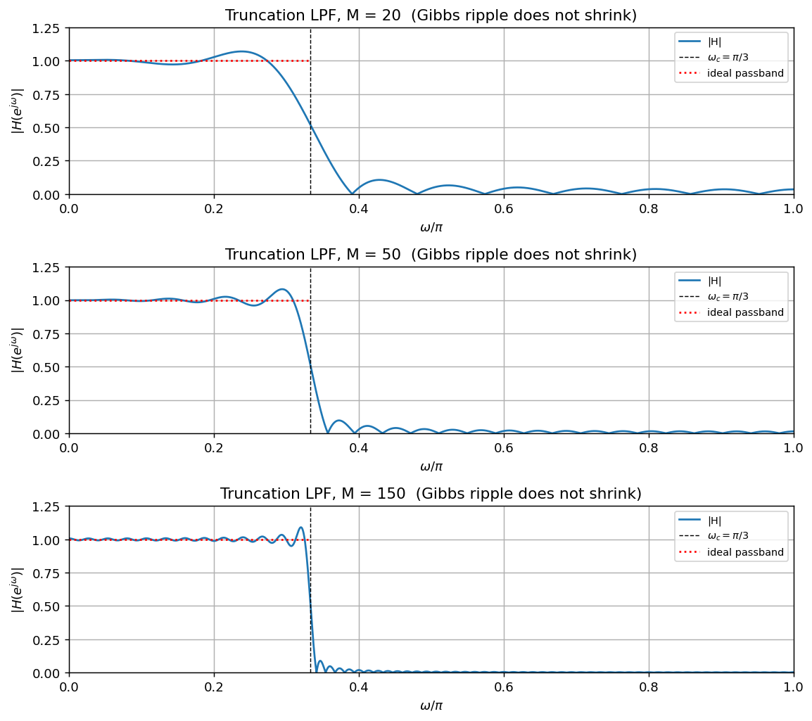

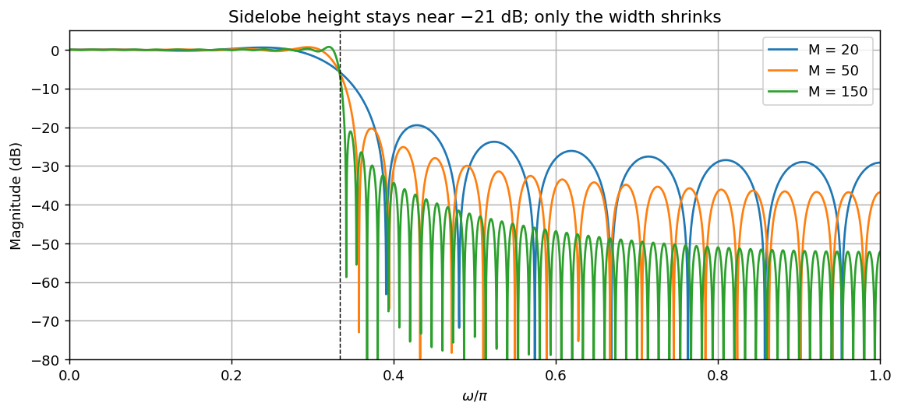

阶数从 20 增到 150，过渡带变窄，但截止频率两侧的起伏高度几乎不变：通带过冲大约 9%，第一旁瓣停在约 \(-21\,\mathrm{dB}\)。这就是 Gibbs 现象。矩形窗的频谱是 sinc，截断相当于和 sinc 卷积，不连续点附近的过冲由窗的主瓣形状决定，加长滤波器只把这个过冲挤向 \(\omega_c\)，并不能把它压下去。

### 1(c) 线性相位

三个滤波器都严格偶对称，对称误差是 0。群延迟恒为 \(M/2\)（10、25、75 个样点）。在 \(|H|>0.2\) 的频点上，展开相位和 \(-(M/2)\omega\) 的偏差在 \(10^{-14}\,\mathrm{rad}\) 量级。阻带里幅度过零会带来 \(\pi\) 的跳变，跳变之间相位仍然是直线，所以是广义线性相位。

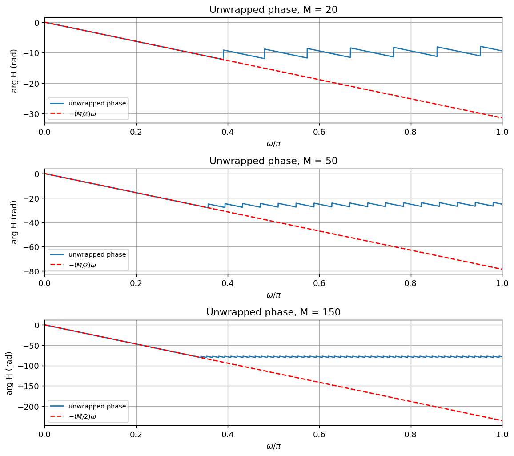

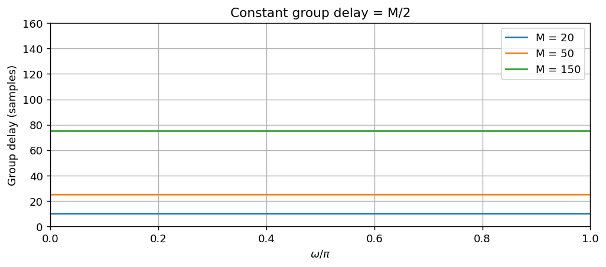

### 1(d) 与 `firls` 相同

无加权的最小二乘 FIR，在理想矩形频率响应下，系数就是傅里叶级数系数，也就是截断后的 sinc。\(M = 20, 50, 150\) 时

\[
\max |h_{\mathrm{trunc}} - h_{\mathrm{firls}}| \approx 1.1\times 10^{-16},
\]

就是双精度舍入，两条冲激响应重合。

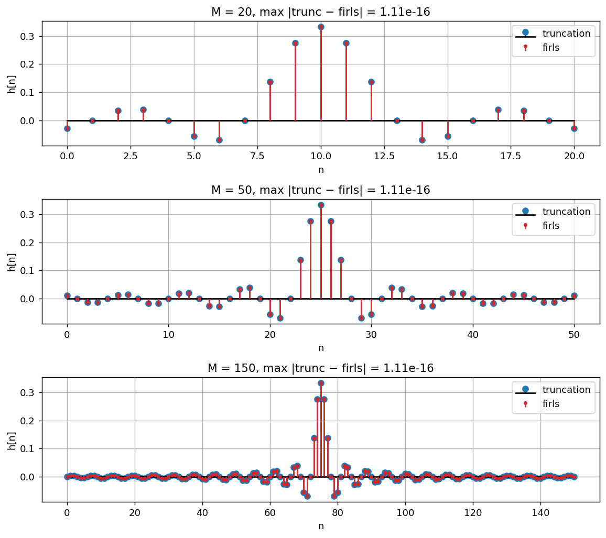

### 1(e) `conv` 和 `filter`

1000 点白高斯噪声，分别和三个 \(h[n]\) 做卷积，再和 `filter(h,1,x)` 比较。

| \(M\) | `conv` 长度 | `filter` 长度 | \(\max|\mathrm{conv}(1:1000)-\mathrm{filter}|\) |
|------:|----------:|-------------:|-----------------------------------------------:|
| 20 | 1020 | 1000 | 0 |
| 50 | 1050 | 1000 | 0 |
| 150 | 1150 | 1000 | 0 |

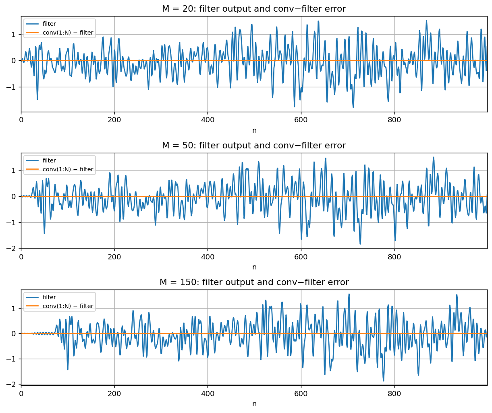

相同点：对 FIR（分母为 1）来说，`filter` 的输出就是线性卷积的前 `length(x)` 个样点，两者在这段上一致。

不同点：`conv` 做的是完整线性卷积，长度是 \(1000+M\)，输入结束后还有 \(M\) 个由滤波器记忆吐出来的尾部。`filter` 只走到输入的最后一个样点就停，不给出这段尾部。另外 `filter` 可以带初始条件、也可以滤波 IIR；`conv` 只表示两个有限序列的卷积。

## 2. Dolph-Chebyshev 窗 FIR 与 Chebyshev II 型 IIR

### 2(a) 旁瓣衰减的影响

用 `fir1` 加 Dolph-Chebyshev 窗，在 \(M = 50\) 上比较旁瓣衰减 40 dB、60 dB、100 dB。

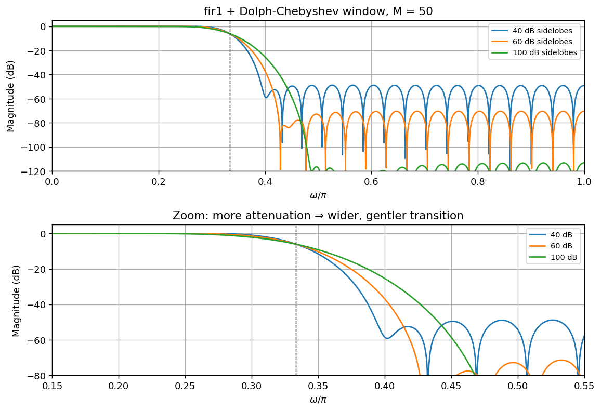

旁瓣衰减给得越高：

1. 通带纹波和阻带旁瓣一起变小。Dolph-Chebyshev 窗的旁瓣是等纹波的，图上 40 dB 的旁瓣最高，100 dB 的旁瓣被压到 \(-100\,\mathrm{dB}\) 以下。
2. 过渡带变宽、斜率变缓。窗在时域两端压得更低，频域主瓣就更宽，和理想矩形卷积之后过渡带被抹开。这是旁瓣高度和过渡带宽度之间的固定交换，阶数不增加就无法两头都要。

后面 IIR 的阻带指标取这组里的 60 dB，便于和窗法 FIR 对着看。

### 2(b)(c) IIR 冲激响应是不是无限长

`cheby2(N, 60, 1/3)` 得到 20、50、150 阶 Chebyshev II 型低通。高阶分母多项式极不稳定，所以频率响应和冲激响应都用二阶节计算。

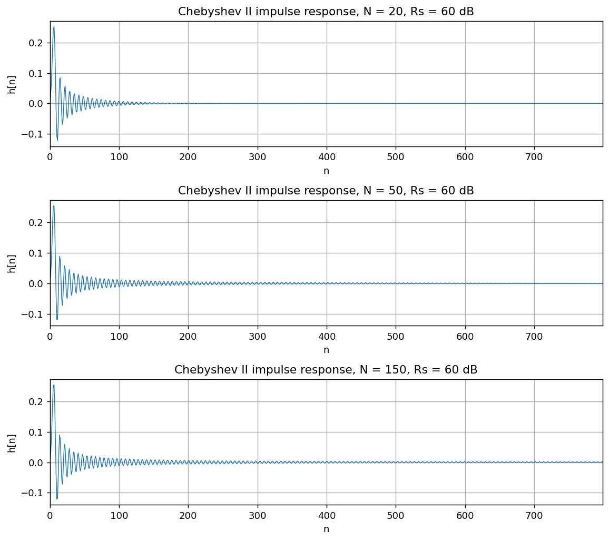

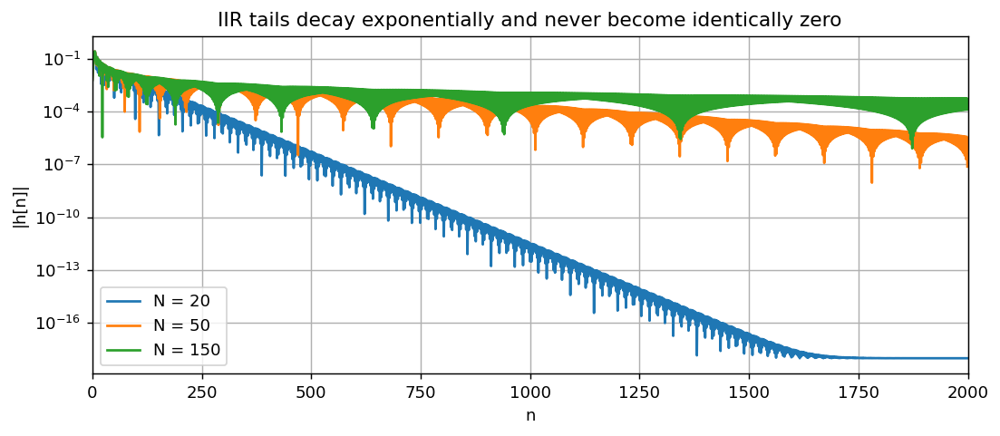

理论上是无限长：极点在单位圆内，\(h[n]\) 按指数衰减，但不会在某个 \(n\) 之后恒等于 0。图上 \(N=20\) 大约 200 点以后已经落到数值零；\(N=50\) 在 \(n=799\) 仍有约 \(5\times 10^{-4}\)，\(N=150\) 仍有约 \(9\times 10^{-4}\)。同样阶数的 FIR 在 \(n>M\) 处精确为 0。所以这些 IIR 看起来会“很快变小”，但并不是有限长。

### 2(d) 和窗法 FIR 比幅度、相位

同一阶数、同一 60 dB 指标。

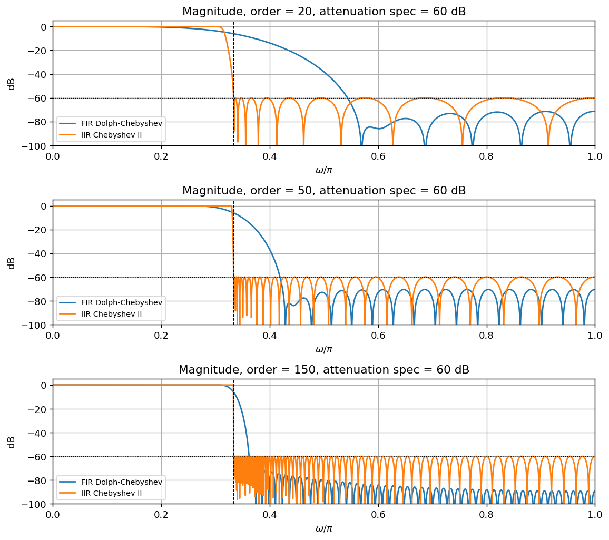

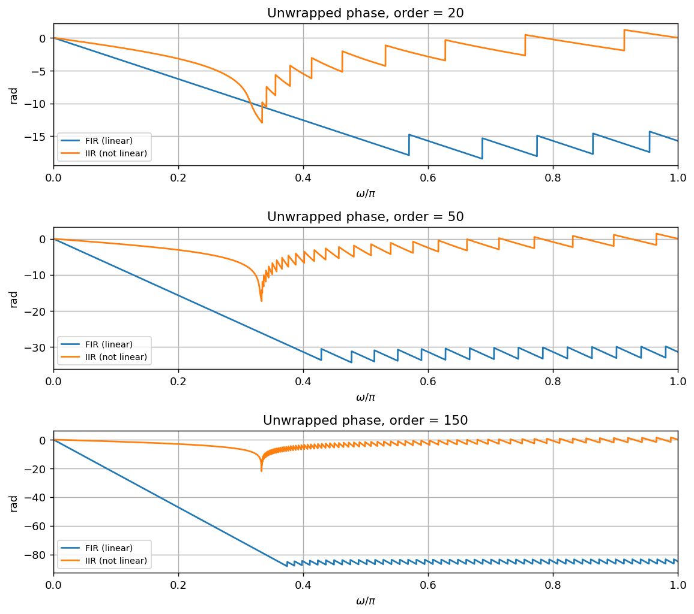

幅度：Chebyshev II 型在阻带等纹波，并且恰好在 \(\omega_c\) 达到 \(-60\,\mathrm{dB}\)，通带单调、几乎没有纹波。窗法 FIR 的旁瓣也大约在这个高度，但过渡带宽得多，通带边缘是缓坡。同样阶数下 IIR 的过渡带窄一个数量级，因为极点可以贴着单位圆，用很少的阶数就把能量集中在截止频率附近。

相位：窗法 FIR 有偶对称，相位是直线（阻带过零处有 \(\pi\) 跳变），群延迟恒定，波形不会散。IIR 的相位在通带里就是弯的，截止频率附近还有一段陡的相位变化。因果且稳定的 IIR 不能具有精确线性相位，除非是平凡的纯延迟；要线性相位就得用 FIR 的对称性，代价是大约 \(M/2\) 的延迟，以及为了同样陡的过渡带必须把阶数加得很高。

### 2(e) 用截断的冲激响应近似 IIR 输出

\(N=20\)、\(R_s=60\,\mathrm{dB}\)，1000 点白噪声。`filter`（二阶节）的输出当作真值，再用截断的 \(h[n]\) 做卷积。

| 保留的冲激响应长度 | 相对误差 \(\|e\|/\|y\|\) |
|------------------:|-------------------------:|
| 50 | \(1.3\times 10^{-1}\) |
| 200 | \(3.8\times 10^{-3}\) |
| 2000 | \(1.4\times 10^{-15}\) |

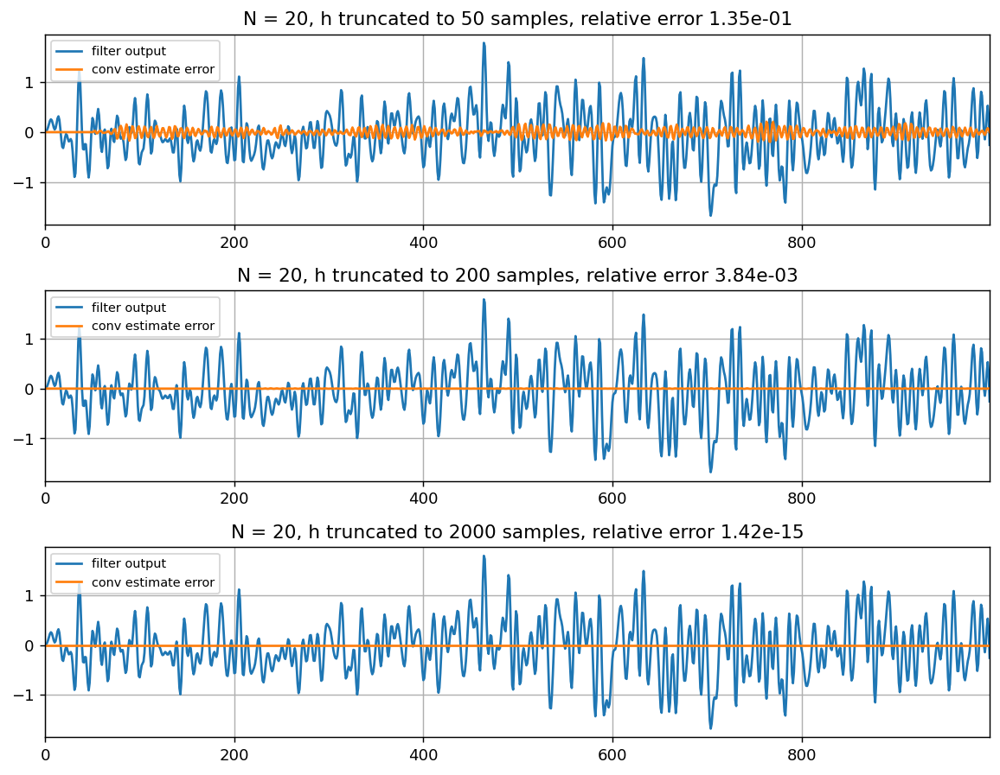

截得太短会丢掉还没衰减完的尾巴，误差清楚可见。长度盖过有效尾巴之后，卷积和 `filter` 一致到舍入误差。所以“很长的冲激响应”这个估计是好的，好到什么程度只取决于尾巴还剩多少能量。阶数更高时极点更靠近单位圆，尾巴更长，必须留更多抽头。

## 3. 护栏杂波里的动目标显示

数据里平台静止，护栏在每个距离上都有回波，而且多普勒为 0。目标在动，多普勒不为 0。不做处理时，每个距离单元都被护栏抬起来，目标埋在里面，所以 Lab 4 的距离谱上看不清车。这一段的示波器照片课上补。

### 3(b-iii) `USE_MTI = 0` 和 `USE_MTI = 1`

`USE_MTI = 0` 就是原来的距离谱：护栏从近处一直铺到最大距离，目标峰不突出。

`USE_MTI = 1` 对相邻两次扫描做

\[
y[n] = x[n] - x[n-1],\quad h[n] = \delta[n] - \delta[n-1].
\]

静止护栏两次扫描几乎一样，相减后抵消；运动目标的相位变了，减不掉。示波器上应看到大片护栏回波塌下去，留下少数几个目标峰。峰会比“没有护栏”的情况矮一些，因为这个高通在目标的多普勒上增益不到 1，同时高频噪声相对被抬高，信噪比变差。这和讲义图 3(e)(f) 一致。

### 3(b-iv)(v) 三脉冲对消器

在 `set_mti_h()` 里加上

\[
y[n] = x[n] - 2x[n-1] + x[n-2],\quad h = \{1,\,-2,\,1\}.
\]

对应代码在 `RadarProcessor_lab5_additions.c`。频率响应是

\[
|H_2(e^{j\omega})| = 2\left|\sin\frac{\omega}{2}\right|, \qquad
|H_3(e^{j\omega})| = 4\sin^2\frac{\omega}{2}.
\]

直流处两者都精确为 0。\(\omega=\pi\) 处二脉冲增益是 2，三脉冲是 4。

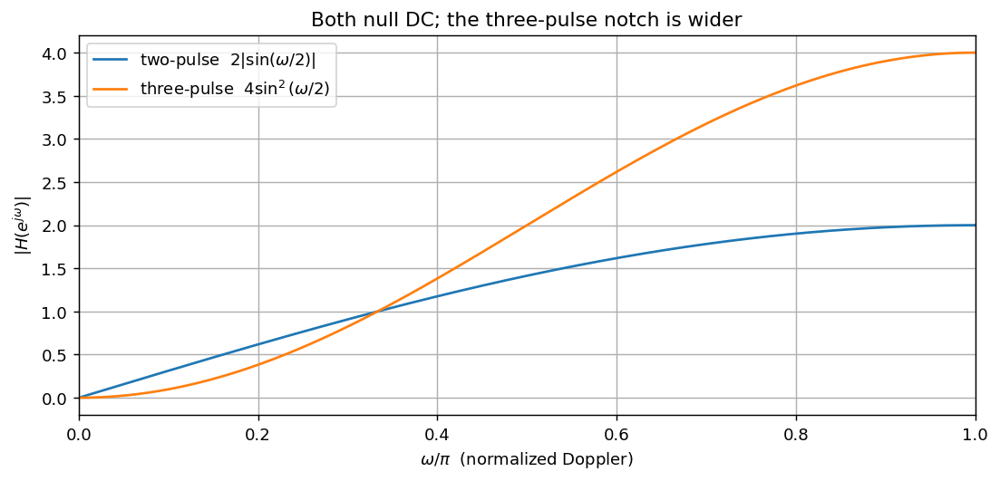

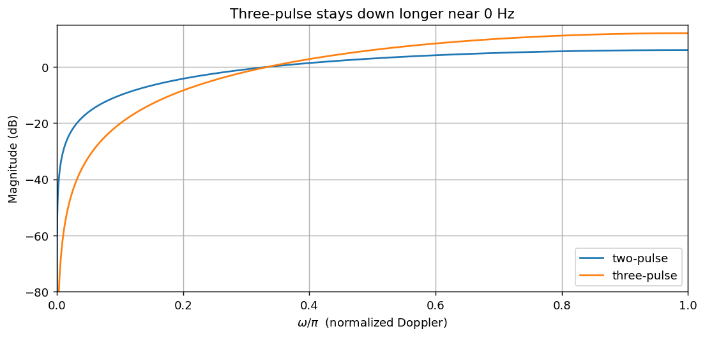

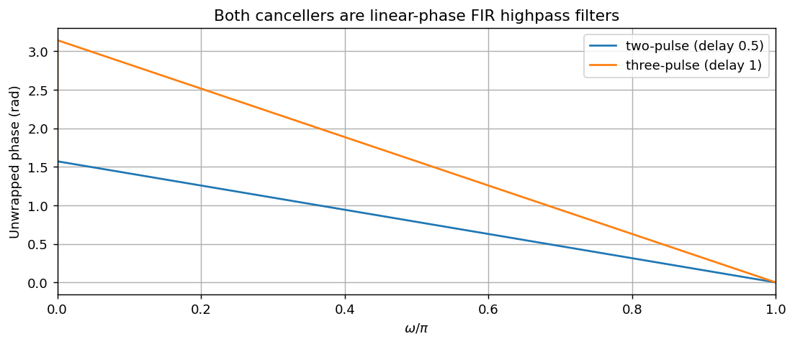

三脉冲在 \(z=1\) 有二重零点，零多普勒附近的凹口更宽、更平，所以对略有谱宽的杂波抑制更好。代价有两个：多普勒比较小的慢目标落在更宽的阻带里，被削得更狠；高频增益从 2 变成 4，噪声被再抬 6 dB，信噪比更差。

对本实验的数据，护栏理想情况下就在 0 Hz，二脉冲已经能消干净。三脉冲不会把消杂波这件事做得“更彻底”，只是对靠近零频的残余更不留情，同时把目标和噪声的比例弄得更不利。示波器上预期是：护栏仍然消失，目标峰还在，但比二脉冲更矮，噪声底相对更高。若目标多普勒本身就不大，三脉冲可能反而把目标一起压没。所以在本题这种“杂波精确在零频、目标多普勒离开零频”的情形里，二脉冲更合适；三脉冲要留到杂波有一定谱宽时再用。

### 3(b-vi) Hann 窗

`prepare_fft_data()` 里在做距离 FFT 之前乘

\[
w_h[n] = 0.5\left(1 - \cos\frac{2\pi n}{N}\right).
\]

窗压低快时间序列两端，减小距离维的频谱泄漏。亮的护栏不再把能量撒进相邻距离单元，目标旁边的地板会降低；主瓣变宽，距离峰变胖、变矮。函数 `hanning_window` 已写在附加 C 文件里。

### 3(b-vii) 平台如果在动

平台速度 \(v_p\) 不为 0 时，静止护栏的多普勒不再是 0，而是

\[
f_{\mathrm{clutter}} = -\frac{v_p}{c} f_{\mathrm{emitted}}.
\]

现在的 \(1 - z^{-1}\) 只在直流有零点，对不上这团杂波，护栏消不掉。改法是把零点挪到杂波多普勒 \(\omega_0 = 2\pi f_{\mathrm{clutter}}/\mathrm{PRF}\) 上：

\[
y[n] = x[n] - e^{j\omega_0} x[n-1].
\]

等价的做法是先按平台运动把每个扫描的相位转回去，让护栏重新落在 0 Hz，然后再用原来的二脉冲或三脉冲对消器。\(\omega_0\) 用平台自身的速度估计，不能再假设它是 0。
